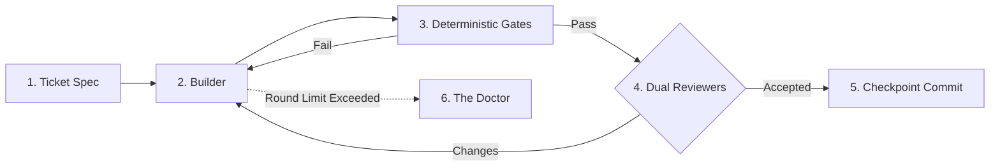

# Agentic Software Factory 🏭

[](LICENSE)
[](https://www.python.org/)
[](#where-it-fits)
[](rules/RULEBOOK.md)

[Try it in 60s](#try-it-in-60-seconds) · [Where it fits](#where-it-fits) · [The 4 roles](#the-4-roles) · [Is it a fit?](#is-it-a-fit) · [Common patterns](#common-patterns)

---

## Where it fits

Most AI coding agents are configured as single chatbots. They write code, test their own code, approve their own work, and inevitably hallucinate:

- They insert **mock stubs and hardcoded returns** to pass their own tests.
- They get stuck in **infinite conversational loops** when builds fail.
- They **mutate Git branches recklessly**, wiping clean code with `git clean` or broken commits.
- They write **verbose documentation padding** instead of verified software.

The **Agentic Software Factory** replaces the conversational chatbot with an **industrial software assembly line**.



### What changes when you put it in the path:

- **Zero self-approving hallucination.** The Builder writes code, but can neither test nor approve its own diff.
- **Zero mock cheats.** Hard constitutional rules (`R-NOFAKE`, `R-ENTRY`) ban mock stubs. Integration tests run against live containers.
- **Zero runaway token loops.** Rounds are strictly capped (default 6). Stalled work transfers to **The Doctor** for forensic classification.
- **Zero Git state vandalism.** Agents are denied `git commit` and `git checkout`. The pipeline harness creates checkpoints only upon dual sign-off.

---

## Try it in 60 seconds

### 1. Scaffold your project (Fastest)

**Option A: Paste to your AI assistant (Antigravity IDE, Claude Code, Cursor, Windsurf)**

```text
Please scaffold the Agentic Software Factory in this repo following this skill:
https://raw.githubusercontent.com/ankur-paan/agentic-software-factory/main/skills/agentic-factory/SKILL.md
```

Your AI automatically detects your project stack (Rust, Go, Python, TypeScript, etc.), configures the gate commands in `harness/config.json`, and installs the 4 roles and rulebook.

**Option B: Terminal one-liner**

```bash
# Linux / macOS:
curl -fsSL https://raw.githubusercontent.com/ankur-paan/agentic-software-factory/main/install.sh | bash

# Windows (PowerShell):
irm https://raw.githubusercontent.com/ankur-paan/agentic-software-factory/main/install.ps1 | iex
```

---

### 2. Or test the dry-run demo (The other way)

Clone and run a full simulation of the assembly line with zero API keys required:

```bash
git clone https://github.com/ankur-paan/agentic-software-factory.git
cd agentic-software-factory
python harness/factory.py --dry-run --ticket specs/TICKET_TEMPLATE.md
```

**Watch the assembly line in real time:**

```text
[2026-10-13 16:50:41] ==================================================
[2026-10-13 16:50:41] Starting Execution for Ticket: TICKET_TEMPLATE
[2026-10-13 16:50:41] ==================================================
[2026-10-13 16:50:41] >>> ROUND 1/6 for TICKET_TEMPLATE <<<
[2026-10-13 16:50:41] Dispatching Builder for TICKET_TEMPLATE (Round 1)
[2026-10-13 16:50:41] --- Running Deterministic Gates for TICKET_TEMPLATE ---
[2026-10-13 16:50:41] [PASS] Gate compile_cmd passed.
[2026-10-13 16:50:41] [PASS] Gate lint_cmd passed.
[2026-10-13 16:50:41] [PASS] Gate test_cmd passed.
[2026-10-13 16:50:41] Dispatching Reviewer A for TICKET_TEMPLATE (Round 1)
[2026-10-13 16:50:41] Dispatching Reviewer B for TICKET_TEMPLATE (Round 1)
[2026-10-13 16:50:41] Review Results: Reviewer A = ACCEPTED, Reviewer B = ACCEPTED
[2026-10-13 16:50:41] [SUCCESS] Ticket TICKET_TEMPLATE ACCEPTED by both Reviewers!
[2026-10-13 16:50:41] Creating Git Checkpoint: checkpoint TICKET_TEMPLATE
```

All execution traces and accepted tickets are recorded under `.factory/state/` (`events.log`, `accepted.txt`).

---

## The 4 Roles

The framework enforces strict separation of powers across four specialized agent personas:

| Role | Responsibility | Strict Boundary |
| :--- | :--- | :--- |
| **[Builder](roles/BUILDER.md)** | Implements the ticket spec in the workspace. | Cannot run builds, run tests, or touch Git state. Leaves diff in working tree. |
| **[Reviewer A](roles/REVIEWER_A.md)** | **Reachability & Wire Execution.** Audits call graphs from ingress down to feature. | Rejects tests that only test memory structs without wire reachability (`R-ENTRY`). |
| **[Reviewer B](roles/REVIEWER_B.md)** | **Contract, Anti-Cheat & Anti-Slop.** Hunts fake constants and documentation filler. | Rejects mock stubs (`R-NOFAKE`), unbounded buffers (`R-BOUND`), and fluff (`R-STE`). |
| **[The Doctor](roles/DOCTOR.md)** | **Forensic Triage & Diagnosis.** Takes stalled tickets when rounds exhaust. | Never modifies product code. Classifies cause (`TASK`, `PRODUCT`, `TEST`, `SPEC`) and issues rulings. |

---

## Common patterns

| Pattern | The situation | What the factory does |
| :--- | :--- | :--- |
| **Autonomous Greenfield Build** | You need to construct a backend or service from scratch across multiple modules. | Breaks work into sequential **Waves** ([`specs/WAVE_EXAMPLE.md`](specs/WAVE_EXAMPLE.md)), checkpointing clean Git commits after each accepted ticket. |
| **Parity / Protocol Migration** | Rewriting legacy code into Rust or Go while maintaining exact behavioral equivalence. | Runs live qualification containers against reference implementations; rejects fake shortcuts. |
| **Continuous Defect Fixing** | Flaky tests or bugs across microservices. | Generates targeted `DR-XX` tickets with failing reproducer tests before writing the fix. |
| **Unbounded Queue Prevention** | LLMs default to unbounded arrays and infinite memory buffers. | Reviewer B automatically rejects any channel or buffer lacking an explicit capacity cap (`R-BOUND`). |

---

## Is it a fit?

| Use Agentic Software Factory when | Look elsewhere when |
| :--- | :--- |
| You want autonomous, multi-hour engineering runs that stay on task without drifting. | You want inline IDE autocomplete for completing single lines or comments. |
| You test against real databases and brokers (PostgreSQL, Redis, Kafka, MQTT). | You prefer unit tests mocked with dummy in-memory fake objects. |
| You need verifiable, clean Git commit histories for enterprise audit. | You want an agent with unrestricted permissions to push directly to `main`. |
| You work in Rust, Go, Python, TypeScript, Erlang, or C++. | You are looking for a closed-source, proprietary SaaS platform. |

---

## The Anti-Cheat Constitution

All agents operate under [`rules/RULEBOOK.md`](rules/RULEBOOK.md). These rules are **immutable** during task loops:

- **`R-NOFAKE`**: Zero mock transports, zero dummy return constants, zero simulated sleep metrics.
- **`R-ENTRY`**: Tests must enter through the real wire protocol, CLI command, or HTTP endpoint.
- **`R-BOUND`**: Every queue, cache, and buffer must state an explicit maximum capacity and overflow policy.
- **`R-DELTA`**: Multi-round convergence. Round 2+ audits only verified fixes and delta diffs; new minor issues defer to non-blocking `LATER` stream.
- **`R-APPLIED`**: Added configuration flags must demonstrably alter runtime behavior under test.
- **`R-CLAIM`**: Benchmark and latency claims must match exact lines in `gates.log`.
- **`R-STE`**: Simplified Technical English. Short sentences, active voice, zero promotional buzzwords.

---

## Measured in Production

Empirical metrics measured across hundreds of autonomous software engineering tickets:

| Engineering Metric | Naive Chatbot Agents | Agentic Software Factory | Impact |
| :--- | :---: | :---: | :--- |
| **Mock Cheats & Fake Stubs** | ~35% pass silently | **0%** (100% caught) | Zero hardcoded constants or dummy mocks reach production (`R-NOFAKE`). |
| **Runaway Token Burn** | Common (10–30+ turns) | **0%** (Hard 6-Round Cap) | Zero wasted spend. Stalls automatically triage to The Doctor. |
| **Reviewer Convergence** | High drift across rounds | **100% Delta Convergence** | Round 2+ reviews `git diff $prev_tree`; minor items deferred to non-blocking `LATER`. |
| **Wire Protocol Reachability** | Untracked (often dead code) | **100% Verified Call Paths** | Every feature must execute through real network/CLI ingress (`R-ENTRY`). |
| **Main Branch Integrity** | Frequent broken builds | **100% Green Checkpoints** | Only commits after passing deterministic gates AND dual reviews. |
| **Autonomous Wave Completion** | Requires constant human babysitting | **85%+ Autonomous First-Pass** | Multi-ticket waves run end-to-end overnight without human intervention. |
| **Minor Findings Cleanup** | Cluttered backlogs | **Automated Wave MN** | The Doctor triages deferred items post-acceptance into dedicated cleanup tasks. |
| **Documentation Precision** | Heavy AI fluff & buzzwords | **100% Simplified Technical English** | Zero marketing slop. Every performance claim cited directly to `gates.log`. |

---

## What else is in the box

- **Autonomous AI Skill.** Packaged under [`skills/agentic-factory/SKILL.md`](skills/agentic-factory/SKILL.md) for instant discovery in Antigravity, Claude Code, and agentic IDEs.
- **File-Based Escalation Inbox.** Asynchronous inbox (`.factory/inbox/escalations` & `.factory/inbox/rulings`) where Antigravity or your AI co-pilot continuously monitors, triages stalled cases, and issues resume rulings.
- **Delta-Only Review & Wave MN Triage.** Built-in 3-tier convergence state machine preventing "moving goalpost syndrome" and auto-batching minor findings.
- **Forensic Triage Protocol.** The complete diagnostic methodology in [`roles/DOCTOR.md`](roles/DOCTOR.md) to root-cause stuck tasks without human intervention.
- **Wave Manifests.** Sequence multiple interconnected tickets into verifiable milestones ([`specs/WAVE_EXAMPLE.md`](specs/WAVE_EXAMPLE.md)).
- **Zero-Dependency Python Harness.** A clean, transparent runner ([`harness/factory.py`](harness/factory.py)) using only Python standard library with CLI and hybrid runner support.

---

## Project

- **License**: MIT License. See [LICENSE](LICENSE).
- **Contributing**: Issues and pull requests welcome!
- **Feedback**: Open a GitHub Issue to share your factory configurations and prompt refinements.
